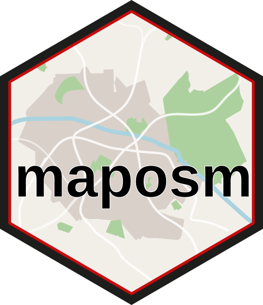
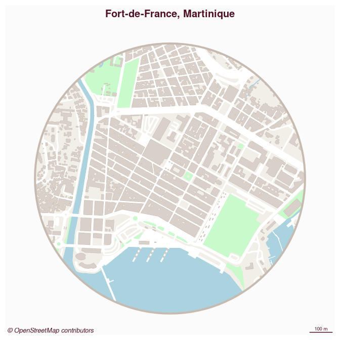

**&#9888; This project has moved to a new location: https://codeberg.org/riatelab/maposm/ &#9888;**

# maposm 

The [OpenStreetMap](https://www.openstreetmap.org/) database provides a
wide range of highly detailed geographic layers on a global scale. To
obtain synthetic information for cartographic purposes, layers must be
selected, simplified, merged, or modified.  
`maposm` downloads OpenStreetMap extracts and performs these operations
to create a set of composite layers of urban areas, buildings, green
spaces, main roads, secondary roads, railways, and water bodies.

<!-- -->

