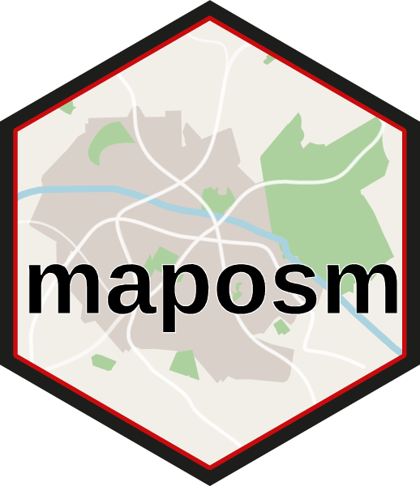
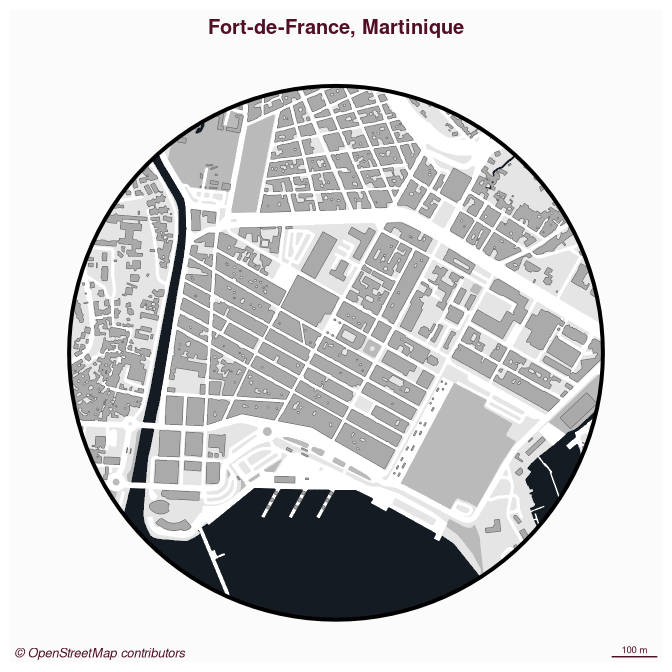
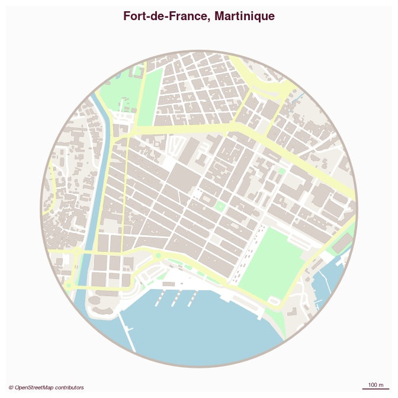

# maposm 

[](https://riatelab.r-universe.dev/maposm)

The [OpenStreetMap](https://www.openstreetmap.org/) database provides a
wide range of highly detailed geographic layers on a global scale. To
obtain synthetic information for cartographic purposes, layers must be
selected, simplified, merged, or modified.  
`maposm` downloads OpenStreetMap extracts and performs these operations
to create a set of composite layers of urban areas, buildings, green
spaces, main roads, secondary roads, railways, and water bodies.

## Installation

You can install `maposm` from the r-universe.

``` r
install.packages("maposm", repos = "https://riatelab.r-universe.dev")
```

## Demo

`om_get()` is used to download, merge and simplify the geographic
layers.  
`om_map()` is used to map the layers.

``` r
library(maposm)
#> Data © OpenStreetMap contributors, ODbL 1.0. https://www.openstreetmap.org/copyright.
#> Maps based on OpenStreetMap data should cite "© OpenStreetMap contributors" as the data source.
f2f = om_get(x = c(-61.070, 14.605), r = 600)
#> # Download the OpenStreetMap file
#> The input place and the radius matched the sample dataset.
#> Skip downloading and data extraction.
#> 
#> # Compose layers
#> - green spaces
#> - buildings
#> - urban areas
#> - roads
#> - streets
#> - railways
#> - water bodies
#> 
#> Done!
om_map(x = f2f, title = "Fort-de-France, Martinique", theme = "light")
```

<!-- -->

Several themes are available to map the layers (“light”, “dark”, “grey”
and “pizza”).

``` r
om_map(x = f2f, title = "Fort-de-France, Martinique", theme = "grey")
```

<!-- -->

You can also use your prefered library to map the layers.

``` r
library(mapsf)
mf_map(f2f$zone, col = "#f2efe9", border = NA, add = FALSE)
mf_map(f2f$urban, col = "#e0dfdf", border = "#e0dfdf", lwd = .5, add = TRUE)
mf_map(f2f$green, col = "#c8facc", border = "#c8facc", lwd = .5, add = TRUE)
mf_map(f2f$water, col = "#aad3df", border = "#aad3df", lwd = .5, add = TRUE)
mf_map(f2f$railway, col = "grey50", lty = 2, lwd = .2, add = TRUE)
mf_map(f2f$street, col = "white", border = "white", lwd = .5, add = TRUE)
mf_map(f2f$road, col = "#f7fabf", border = "#f7fabf", lwd = .5, add = TRUE)
mf_map(f2f$building, col = "#d9d0c9", border = "#c6bab1", lwd = .5, add = TRUE)
mf_map(f2f$zone, col = NA, border = "#c6bab1", lwd = 4, add = TRUE)
mf_credits(txt = "\ua9 OpenStreetMap contributors")
mf_scale(size = 100, scale_units = "m")
mf_title("Fort-de-France, Martinique")
```

<!-- -->

`om_write()` can be used to write the layers to a geopackage file.  
`om_read()` can be used to read the geopackages.

``` r
# save
om_write(x = f2f, filename = "f2f.gpkg")
# import
om_read(x = "f2f.gpkg")
```

## Alternatives

- [`osmdata`](https://github.com/ropensci/osmdata) to access to OSM data
  through the overpass API
- [`osmplotr`](https://docs.ropensci.org/osmplotr/) from the author of
  `osmdata`
- [`osmextract`](https://docs.ropensci.org/osmextract/) for large
  extracts from OSM
- [`prettymap`](https://github.com/marceloprates/prettymaps) is a full
  featured Python library
- [`mapBliss`](https://github.com/benyamindsmith/mapBliss) to plot
  flight paths and road trips on OSM map
- [`maptiles`](https://github.com/riatelab/maptiles) to download
  (raster) OSM map tiles
- [`cartographr`](https://github.com/da-wi/cartographr) to plot OSM
  layers using `ggplot2`
- [`rcityviews`](https://github.com/koenderks/rcityviews) Map a
  selection of cities + R shiny interface

## Community Guidelines

One can contribute to the package through [pull
requests](https://github.com/riatelab/maposm/pulls) and report issues or
ask questions [here](https://github.com/riatelab/maposm/issues). This
project uses [conventional
commits](https://www.conventionalcommits.org/en/v1.0.0-beta.3/) and
[semantic versioning](https://semver.org/).
